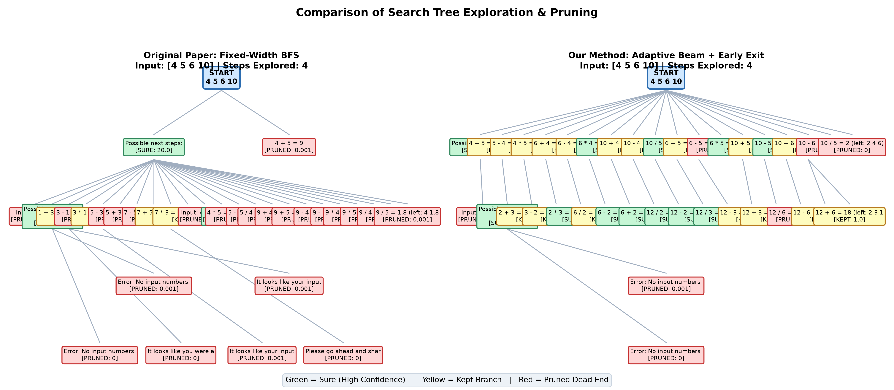
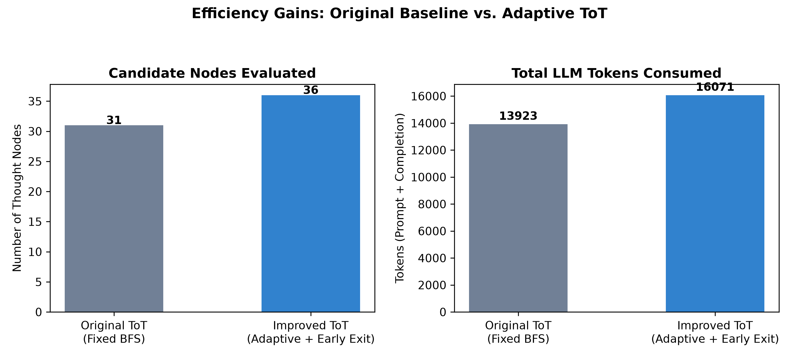

 # Adaptive Tree of Thoughts (Adaptive-ToT)

**Dynamic Beam Pruning and Early-Exit Verification for Token-Efficient LLM Reasoning**

[](https://arxiv.org)
[](#)

This repository reproduces the official Princeton NLP **Tree of Thoughts (ToT)** framework and introduces **Adaptive-ToT**—an algorithmic extension designed to reduce redundant LLM API calls, token consumption, and latency on lightweight models.

---

## Key Innovations & Engineering Contributions

1. **Confidence-Driven Dynamic Beam Pruning (`src/tot/methods/adaptive_bfs.py`):**
   - Automatically filters out dead-end states (`value <= 0.01`).
   - Dynamically collapses the search beam width to $b_t = 1$ whenever a high-confidence (`sure`, $v_{\max} \ge 20$) path is detected, avoiding wasted exploration across parallel branches.
2. **Early-Exit Terminal Verification (`src/tot/methods/adaptive_bfs.py`):**
   - Evaluates retained intermediate states against `task.test_output()` at every depth and halts search expansion immediately upon finding a valid terminal solution.
3. **Modern Gemini REST API Adapter (`src/tot/models.py`):**
   - Migrates the legacy 2023 OpenAI SDK wrapper to Google's `gemini-3.5-flash-lite` REST endpoint with `x-goog-api-key` authentication, token usage tracking, and resilient `429`/`503` rate-limit retry handling.
4. **Automated Search-Tree & Efficiency Visualization (`compare_diagrams.py`):**
   - Parses JSON execution logs to render side-by-side color-coded search trees and token/node efficiency comparisons.

---

## Visual Comparison: Original BFS vs. Adaptive-ToT

### Search Tree Exploration & Pruning


### Node & Token Consumption Efficiency


---

## Quickstart & Reproducibility

### 1. Environment Setup
```bash
git clone https://github.com
cd adaptive-tree-of-thoughts
pip install -e . --no-deps
pip install requests matplotlib numpy sympy
```

### 2. Set Your Gemini API Key
**Windows PowerShell:**
```powershell
\$env:OPENAI_API_KEY="YOUR_GEMINI_API_KEY"
```

### 3. Run Original Baseline vs. Adaptive-ToT
* **Original Paper Baseline (`bfs`):**
  ```bash
  python run.py --backend gemini-3.5-flash-lite --task game24 --task_start_index 900 --task_end_index 901 --method_search bfs --method_generate propose --method_evaluate value --method_select greedy --n_evaluate_sample 1 --n_select_sample 2
  ```

* **Improved Algorithm (`adaptive`):**
  ```bash
  python run.py --backend gemini-3.5-flash-lite --task game24 --task_start_index 900 --task_end_index 901 --method_search adaptive --method_generate propose --method_evaluate value --method_select greedy --n_evaluate_sample 1 --n_select_sample 2
  ```

### 4. Generate Comparison Diagrams
```bash
python compare_diagrams.py
```

---

## Citation & Acknowledgment
Built upon the original Tree of Thoughts codebase by Yao et al. (2023):
```bibtex
@inproceedings{yao2023tree,
  title={Tree of Thoughts: Deliberate Problem Solving with Large Language Models},
  author={Yao, Shunyu and Yu, Dian and Zhao, Jeffrey and Shafran, Izhak and Griffiths, Thomas L and Cao, Yuan and Narasimhan, Karthik},
  booktitle={Advances in Neural Information Processing Systems (NeurIPS)},
  year={2023}
}
```
